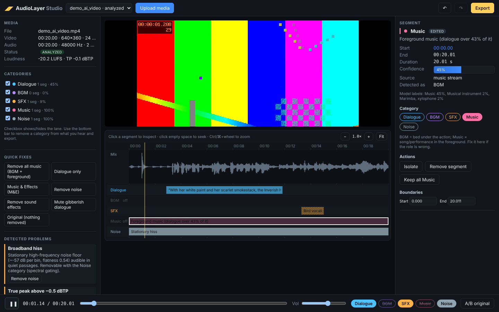
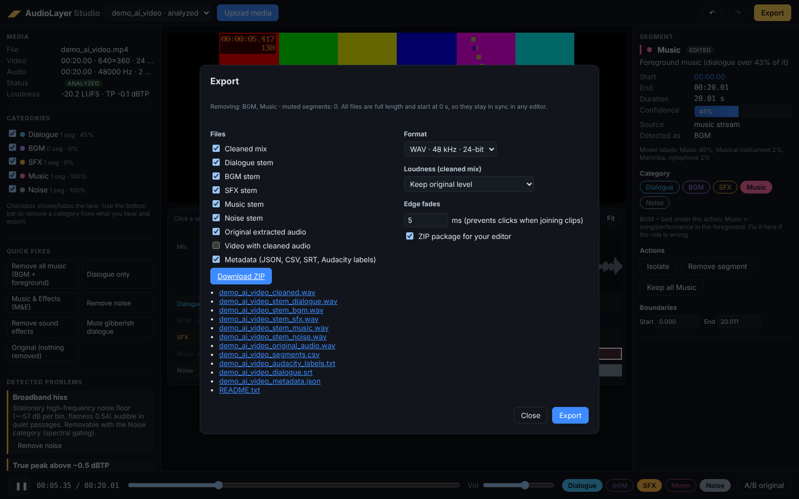

# AudioLayer Studio

**Detect → Classify → Preview → Isolate / Remove → Export** — an open-source audio clean-up workstation
for videos made with AI video generators (Veo, Sora, Kling, Wan, Runway…), usable from a web UI and from
Claude through the Model Context Protocol.

Upload a generated clip, and AudioLayer extracts the audio, finds **Dialogue, BGM, SFX, foreground Music
and Noise** on a timeline (with confidence scores and overlaps), separates them with real source-separation
models, lets you remove or isolate whole categories or single segments, and exports synchronised stems,
a cleaned mix, the video with replaced audio, and metadata for your editor.

> 📘 **Step-by-step tutorial (install, web app, Claude Desktop, Claude Code):**
> [🇬🇧 English](docs/TUTORIAL.en.md) · [🇮🇩 Bahasa Indonesia](docs/TUTORIAL.md)
>
> 🎬 **Demo video (41 s):** [docs/media/audiolayer_promo.mp4](docs/media/audiolayer_promo.mp4)
>
> **Works with Claude, even with nothing installed:** add the skill ([download audiolayer.zip](https://github.com/zallxz/AudioLayer-Studio/raw/main/skills/audiolayer.zip))
> in the Claude app, upload a clip and type `/audiolayer` — Claude installs the torch-free engine in its own sandbox, detects
> what's in the audio, asks what to remove and gives you the cleaned files ([cloud mode](#cloud-mode-no-install-in-claude)).
> Or connect `audiolayer-mcp` to Claude Desktop / Claude Code for local files ([Using it from Claude](#using-it-from-claude-mcp)).

> Status: working end-to-end MVP (v0.1). What works, what needs model downloads and what is still
> limited is listed explicitly in [Limitations](#limitations) and [docs/MODELS.md](docs/MODELS.md).

## Contents
[Features](#features) · [Screenshots](#screenshots) · [Architecture](#architecture) ·
[Tutorial EN](docs/TUTORIAL.en.md) / [ID](docs/TUTORIAL.md) · [Installation](#installation) · [Running](#running) · [Claude / MCP](#using-it-from-claude-mcp) ·
[Exports](#export-formats) · [Limitations](#limitations) · [Troubleshooting](#troubleshooting) ·
[Development](#development) · [License](#license)

## Features

- **Media upload** – MP4, MOV, MKV, WebM, WAV, MP3, AAC/M4A, FLAC. FFmpeg extraction to a 48 kHz working
  master; the original is copied, made read-only and never modified. Corrupt/unsupported files, size and
  duration limits are handled with clear errors.
- **Detection & classification** – time-based, overlap-aware segments for the five categories with
  confidence scores, AudioSet labels as descriptions, `uncertain` flags instead of forced labels, and a
  transparent BGM-vs-Music rule you can override.
- **Speech** – Whisper transcription with timestamps (SRT export) and an **intelligibility score** that
  flags AI "gibberish" dialogue.
- **Source separation** – Demucs v4 (vocals/accompaniment) + classifier-guided routing into
  voice / music / effects streams + a noise chain built only for measured noise. Streams sum back to the
  original exactly, so removal is non-destructive and reversible.
- **Selective removal** – remove any combination of categories, mute or isolate single segments, presets
  (*Remove all music*, *Dialogue only*, *Music & Effects*, *Mute gibberish*, *Remove noise/SFX*), undo/redo.
- **Interactive timeline** – waveform, colour-coded category lanes, zoom, seek, segment inspector,
  relabel / re-time, per-category preview toggles and an A/B switch against the original (Web Audio,
  sample-accurate — what you hear is what you export), synced video preview.
- **Creator problem report** – silent/missing audio, clipping, mains hum, hiss, rumble, DC offset,
  band-limited ("muffled") audio, edge clicks, stereo phase, loudness/true peak — each with a suggested fix.
  See [docs/CREATOR_PROBLEMS.md](docs/CREATOR_PROBLEMS.md).
- **Export** – cleaned mix, five stems, original audio (WAV 48 kHz/24-bit, FLAC, MP3), video with the
  cleaned audio (video stream copied), loudness presets (−14/−16/−23 LUFS), edge fades, JSON + CSV + SRT +
  Audacity labels, ZIP package.
- **Easy use** – one-step installers, a double-click launcher, `audiolayer clean clip.mp4 --preset remove_music`
  one-liners, `audiolayer doctor`, `audiolayer setup-claude`, and a Claude skill.
- **Claude integration** – MCP server with 13 tools (stdio for Claude Desktop/Code; Streamable HTTP with
  bearer auth for remote connectors), long-running jobs with polling and cancellation.
- **Local-first** – all processing runs on your machine; no paid APIs; nothing is uploaded anywhere.

## Screenshots

Captured from the test build using the synthetic demo clip (`scripts/make_demo_media.py`) — replace
with your own captures.




## Architecture

FastAPI backend (`backend/audiolayer`) with a service façade shared by the REST API and the MCP server, a
threaded job manager, file-based project store, and swappable model adapters; React + TypeScript + Vite
frontend (`frontend/`). Details and diagrams: [docs/ARCHITECTURE.md](docs/ARCHITECTURE.md).

| Role | Default model | License | Install |
|---|---|---|---|
| Sound event detection | PANNs CNN14 (framewise, 527 AudioSet classes) | MIT | `ml` extra; weights ~312 MB on first use |
| Separation | Demucs v4 `htdemucs` | MIT | `ml` extra; weights ~84 MB on first use |
| Speech recognition | faster-whisper `base` | MIT | `ml` extra; weights ~145 MB on first use |
| Noise reduction | scipy filters + noisereduce | BSD / MIT | core |
| Fallback classifier | DSP heuristic (low accuracy, flagged) | Apache-2.0 | core |

Why these, alternatives, hardware numbers and **measured** separation quality: [docs/MODELS.md](docs/MODELS.md).

## Installation

Requirements: **Python 3.11+**, **FFmpeg** (with `ffprobe`), **Node.js 20+** (only to build the UI),
~2 GB disk for Python packages + ~550 MB for model weights. A GPU is optional.

### Quick install (recommended)

```bash
git clone https://github.com/zallxz/AudioLayer-Studio.git && cd AudioLayer-Studio
./install.sh                                            # macOS / Linux
# Windows: powershell -ExecutionPolicy Bypass -File install.ps1
```

The installer checks/installs Python 3.11+ and FFmpeg, creates `.venv`, installs PyTorch (CPU, CUDA or
Apple Silicon) and AudioLayer, downloads the models, creates a double-click launcher
(`AudioLayer.command` / `AudioLayer.bat`) and connects Claude Desktop (and Claude Code if installed).
`--lite` skips PyTorch; `--yes` answers every question with yes. Then:

```bash
audiolayer web                                                         # app in your browser
audiolayer clean clip.mp4 --preset remove_music --loudness youtube --video   # one command, no UI
audiolayer doctor                                                      # check the installation
```

The manual steps below do the same thing by hand.

### 1. FFmpeg

| OS | Command |
|---|---|
| macOS | `brew install ffmpeg` |
| Windows | `winget install Gyan.FFmpeg` (or `choco install ffmpeg`), then open a new terminal |
| Ubuntu/Debian | `sudo apt install ffmpeg libsndfile1` |
| Fedora | `sudo dnf install ffmpeg libsndfile` (RPM Fusion) |

Check: `ffmpeg -version` and `ffprobe -version`.

### 2. Backend

```bash
git clone https://github.com/zallxz/AudioLayer-Studio.git
cd audiolayer-studio
python -m venv .venv
source .venv/bin/activate          # Windows: .venv\Scripts\activate

# PyTorch first, matching your hardware (see https://pytorch.org/get-started/locally/):
pip install torch --index-url https://download.pytorch.org/whl/cpu      # CPU (Linux/Windows)
# pip install torch                                                     # macOS (MPS) or CUDA default wheels

pip install -e ".[ml]"             # app + neural models
# pip install -e .                 # "lite": no PyTorch → heuristic detection only, no separation
cp .env.example .env               # optional; edit paths/limits
```

### 3. AI model setup (optional pre-download)

Weights download automatically on first analysis. To fetch them up-front (or for offline machines):

```bash
python scripts/download_models.py            # PANNs + Demucs + Whisper (~550 MB)
python scripts/download_models.py --list     # status, sizes, licenses
```

Then set `AUDIOLAYER_ALLOW_MODEL_DOWNLOAD=false` to forbid any further downloads.

### 4. Frontend (optional)

A prebuilt UI ships inside the Python package (`backend/audiolayer/web_dist`), so Node.js is only needed
when you change the UI. `npm run build` writes `frontend/dist` (used in preference); `npm run build:bundle`
refreshes the bundled copy.

```bash
cd frontend
npm ci
npm run build        # outputs frontend/dist, served by the backend at http://127.0.0.1:8000
```

### Docker

```bash
docker compose up --build          # http://127.0.0.1:8000  (CPU image, models download into the volume)
```

## Running

```bash
# Backend + built UI
audiolayer-api                       # http://127.0.0.1:8000
# Frontend dev server with hot reload (proxies /api to :8000)
cd frontend && npm run dev           # http://127.0.0.1:5173
```

By default the web app, the CLI and Claude share one workspace at `~/AudioLayer/workspace`.
Environment variables are documented in [.env.example](.env.example) (workspace, model dir, device,
model choices, upload/duration limits, input folders for MCP, auth tokens).

Try it without your own media: `python scripts/make_demo_media.py ./demo` builds a 20 s test video with
known ground-truth stems (speech + music + effects + hiss/hum); after analysing it,
`python scripts/evaluate.py ~/AudioLayer/workspace <project_id> ./demo` prints the measured separation quality.

## Using it from Claude (MCP)

### Local — Claude Desktop / Claude Code (stdio)

One command writes the config for you (existing config is backed up and merged):

```bash
audiolayer setup-claude --input-dir ~/Movies/ai-clips          # add --code for Claude Code too
```

Or by hand — find the executable with `which audiolayer-mcp` (Windows: `where audiolayer-mcp`) and add to `claude_desktop_config.json` (macOS `~/Library/Application Support/Claude/`, Windows `%APPDATA%\Claude\`):

```json
{
  "mcpServers": {
    "audiolayer": {
      "command": "/absolute/path/to/.venv/bin/audiolayer-mcp",
      "env": {
        "AUDIOLAYER_WORKSPACE": "/absolute/path/to/AudioLayer/workspace",
        "AUDIOLAYER_INPUT_DIRS": "/absolute/path/to/your/ai-video-clips"
      }
    }
  }
}
```

Restart Claude Desktop and ask, e.g. *"Analyze scene12.mp4 in my ai-video-clips folder, tell me what's in
the audio, remove the background music and export a YouTube-loudness version with the video."*
Claude Code: `claude mcp add audiolayer --env AUDIOLAYER_INPUT_DIRS=$HOME/Movies -- audiolayer-mcp`.
Inspect the server without Claude: `npx @modelcontextprotocol/inspector audiolayer-mcp`.

The MCP server can only read files inside `AUDIOLAYER_INPUT_DIRS` (symlinks are resolved and checked).

### Remote — Claude on the web (custom connector)

A server on your laptop is **not** reachable by claude.ai. For the web app you must deploy the server
on a host with a public HTTPS URL:

```bash
AUDIOLAYER_AUTH_TOKENS="me:$(openssl rand -hex 24)" \
AUDIOLAYER_PUBLIC_BASE_URL=https://audiolayer.example.com \
AUDIOLAYER_ALLOWED_HOSTS=audiolayer.example.com \
audiolayer-api --host 127.0.0.1 --port 8000 --remote-mcp      # behind a TLS reverse proxy
```

MCP endpoint: `https://audiolayer.example.com/mcp/`. Requests need `Authorization: Bearer <token>`;
media is uploaded via single-use URLs from the `create_upload_url` tool; projects belong to the token's
user. Static tokens suit personal/team deployments — for a public service, front it with OAuth 2.1.
Full guide, tool reference and example calls: [docs/MCP.md](docs/MCP.md).

### Example tool calls

```jsonc
{"tool": "analyze_media",          "arguments": {"file_path": "/Users/me/clips/scene12.mp4"}}
{"tool": "get_processing_status",  "arguments": {"job_id": "job_9a…"}}
{"tool": "list_audio_segments",    "arguments": {"project_id": "prj_3f…", "category": "dialogue"}}
{"tool": "update_segment_category","arguments": {"project_id": "prj_3f…", "segment_id": "seg_12…", "category": "music"}}
{"tool": "remove_audio_category",  "arguments": {"project_id": "prj_3f…", "preset": "remove_music"}}
{"tool": "export_cleaned_audio",   "arguments": {"project_id": "prj_3f…", "loudness_preset": "youtube", "include_video": true}}
{"tool": "export_audio_stems",     "arguments": {"project_id": "prj_3f…", "format": "wav"}}
```

### Cloud mode (no install, in Claude)

AudioLayer has two engines:

| Engine | Install | Used for |
|---|---|---|
| `torch` | `pip install -e ".[ml]"` (PyTorch, ≈2.5 GB) | your own computer / server, GPU acceleration |
| `onnx` ("cloud") | `pip install "audiolayer-studio[cloud] @ https://github.com/zallxz/AudioLayer-Studio/archive/refs/heads/main.zip"` (≈300 MB, PyPI only) | Claude's code-execution sandbox, small machines, CPU-only servers |

The cloud engine runs the same models (PANNs, Demucs htdemucs, Whisper) through ONNX Runtime and
CTranslate2; model weights (≈400 MB) download from this repository's
[`model-weights`](https://github.com/zallxz/AudioLayer-Studio/tree/model-weights) branch with SHA-256
checks, and FFmpeg comes from the `imageio-ffmpeg` wheel if the machine has none — so it needs only
PyPI + GitHub access. `AUDIOLAYER_ENGINE=auto` (default) picks `torch` when PyTorch is installed,
otherwise `onnx`. On the demo scene the ONNX engine measured +7.6 dB dialogue SI-SDR improvement
(PyTorch path: +6.6 dB; the difference comes from segment overlap handling, not the network).

With the [skill](skills/audiolayer/SKILL.md) installed in the Claude app (and *Code execution* enabled
with network access to PyPI and GitHub), the user just uploads a clip and types `/audiolayer`: Claude installs the cloud
engine in its sandbox, runs `audiolayer analyze`, shows what it found, asks which layers to remove,
runs `audiolayer clean --project …` and returns the files. Processing takes ≈1.5–2× the clip length;
upload limits of the app apply, so it suits short generated clips best.

### Claude skill

[`skills/audiolayer/SKILL.md`](skills/audiolayer/SKILL.md) teaches Claude when and how to use AudioLayer —
mapping requests like "remove the music", "the characters speak gibberish" or "I want to dub it" to the
right preset, running the MCP tools or the CLI, waiting for jobs and reporting limitations honestly.
Install it in Claude: download **[audiolayer.zip](https://github.com/zallxz/AudioLayer-Studio/raw/main/skills/audiolayer.zip)** and upload it in *Settings → Capabilities →
Skills*, or copy the folder to `~/.claude/skills/` for Claude Code. After editing `SKILL.md`, rebuild the
ZIP with `python scripts/build_skill_zip.py` (a test checks it is current).

## Export formats

| Output | Details |
|---|---|
| Cleaned mix | Original minus removed categories and muted segments; optional loudness preset and edge fades |
| Stems | `dialogue`, `bgm`, `sfx`, `music`, `noise` — full length from t=0, silence preserved, sample-accurate |
| Original audio | The extracted working master |
| Video | Original video stream copied (no re-encode) + cleaned audio (AAC 320k; FLAC in MKV) |
| Audio formats | WAV PCM 48 kHz / 24-bit · FLAC 48 kHz · MP3 320 kbps |
| Metadata | `*_metadata.json` (everything, schema `audiolayer.metadata/v1`), `*_segments.csv`, `*_dialogue.srt`, `*_audacity_labels.txt` (import as a label track) |
| Package | ZIP with all of the above + README.txt explaining the files |

Stems (before loudness normalisation) sum back to the original audio.

## Limitations

Stated plainly, because over-promising separation helps nobody:

- **Music vs. effects that overlap in time are not cleanly separable** with the current models. Demucs
  separates *voice* from *everything else*; inside the non-voice part, music and effects are split by
  classifier time-weights plus a REPET-SIM soft mask in effect regions. Overlapping segments are flagged
  `overlaps_music_split_estimated`. A cinematic dialogue/music/effects model (e.g. Bandit on DnR) would
  improve this and fits the `Separator` interface.
- **Percussive or tonal sound effects** (synthetic hits, risers) are often classified as music.
- **BGM vs. foreground Music** is a role, not an acoustic property — it is decided by a rule and flagged
  when uncertain; correct it in the inspector.
- **Gibberish detection** is a confidence heuristic from the speech recogniser; accents or mumbling can
  also be flagged.
- **Clipping and missing high frequencies cannot be repaired** — they are reported, not fixed.
  Non-stationary noise (wind gusts) is detected but not removed.
- **Speed**: roughly real time on a laptop CPU; a CUDA GPU is much faster. Defaults limit uploads to
  2 GB / 30 min (configurable).
- Measured quality on a synthetic scene is in [docs/MODELS.md](docs/MODELS.md); real generator output varies.
- The heuristic (no-PyTorch) mode is for trying the app; its labels are low accuracy and it cannot separate.

## Troubleshooting

| Symptom | Fix |
|---|---|
| `FFmpeg not found on PATH` | Install FFmpeg (above) and restart the terminal / Claude Desktop. On macOS GUI apps may not see Homebrew's PATH — put the full path in `PATH` inside the MCP `env`. |
| "No source-separation model available" | Install the `ml` extra (`pip install -e ".[ml]"`) and PyTorch. |
| Model download fails / offline | `python scripts/download_models.py` on a connected machine, copy `AUDIOLAYER_MODEL_DIR` and the torch hub cache (`~/.cache/torch/hub/checkpoints`). |
| Claude Desktop doesn't list the tools | Use the absolute path to `audiolayer-mcp`; check Claude's MCP logs (`~/Library/Logs/Claude/mcp*.log` / `%APPDATA%\Claude\logs`). |
| `[forbidden] Path is outside the allowed input folders` | Add the folder to `AUDIOLAYER_INPUT_DIRS` (separate several with `:` on macOS/Linux, `;` on Windows). |
| Analysis is slow | Expected on CPU (~1.3–1.6× real time). Use a GPU, `AUDIOLAYER_WHISPER_MODEL=tiny`, or untick transcription. |
| Claude (cloud mode) can't install / download models | Enable *Code execution* in Claude's *Settings → Capabilities* and allow at least package managers (PyPI + GitHub). |
| Out of memory on long files | Lower `AUDIOLAYER_CHUNK_SECONDS` (e.g. 15). |
| Browser plays nothing | Click Play once (browsers block audio until a user gesture); check that the project status is `analyzed`. |
| 401 in the UI | The server has `AUDIOLAYER_AUTH_TOKENS` set — paste your token when prompted. |
| Remote MCP returns 421 | Add your public host to `AUDIOLAYER_ALLOWED_HOSTS` (DNS-rebinding protection). |

## Development

```bash
pip install -e ".[ml,dev]"
ruff check backend tests scripts && mypy
pytest -q                     # fast suite: synthetic audio + test doubles, no weights needed
pytest -q -m models -s        # real PANNs + Demucs + Whisper on a ground-truth scene (downloads weights)
cd frontend && npm run build  # type-check + build
```

CI (`.github/workflows/ci.yml`) runs lint, type-check, tests on Python 3.11–3.13 and the frontend build;
the real-model test runs weekly or on demand. Model weights, media and secrets are git-ignored.

Contributions welcome — especially new `Separator`/`Classifier` adapters (cinematic DnR separation,
BEATs/AST classifiers, DeepFilterNet speech enhancement). Keep adapters license-clean and document
their measured quality.

## License

Code: [Apache-2.0](LICENSE). Vendored PANNs inference code: MIT (Qiuqiang Kong). The AudioSet label list
(`backend/audiolayer/models/data/audioset_labels.csv`) is from Google's AudioSet ontology, CC BY 4.0.
Model weights are downloaded from their authors and keep their own licenses (PANNs MIT, Demucs MIT,
Whisper MIT) — check them before commercial use. Demo audio fetched by `make_demo_media.py` is not
redistributed (LibriSpeech CC BY 4.0, Kevin MacLeod CC BY, freesound CC BY).
